# Quizzkit

**Créer, habiller et faire tourner en direct n'importe quel jeu de quiz**, avec une régie, un animateur, des
joueurs sur tablettes ou téléphones, et des sorties 1920×1080 prêtes pour OBS et vMix.

Outil interne, pensé pour le plateau : tout tourne sur un PC du réseau local, sans internet pendant le show,
et **rien ne doit casser en direct** (journal de chaque action, reprise après plantage, serveur de secours,
annulation de tout).

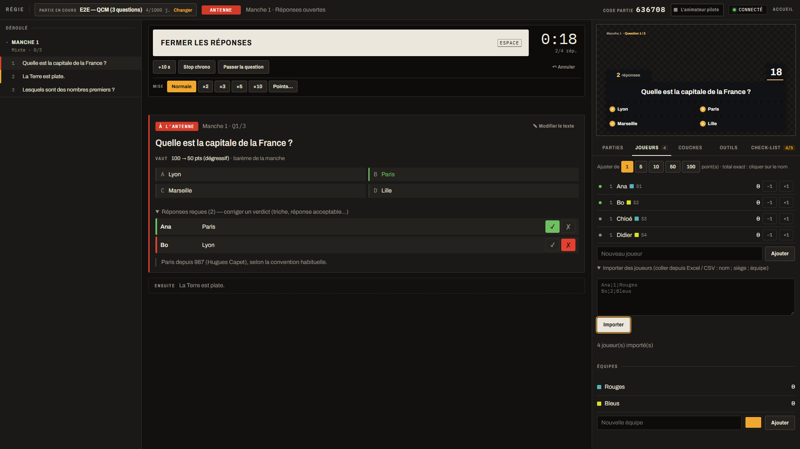

---

## Sommaire

- [Ce que fait l'app](#ce-que-fait-lapp)
- [Les écrans](#les-écrans)
  - [Accueil](#accueil) · [Studio](#studio) · [Régie](#régie) · [Animateur](#animateur) · [Tablettes joueurs](#tablettes-joueurs) · [Sorties OBS / vMix](#sorties-obs--vmix)
- [Types de questions et de manches](#types-de-questions-et-de-manches)
- [Démarrer](#démarrer)
- [Un show, pas à pas](#un-show-pas-à-pas)
- [Fiabilité en direct](#fiabilité-en-direct)
- [Pilotage externe (Stream Deck, OSC, buzzers)](#pilotage-externe-stream-deck-osc-buzzers)
- [Pour les développeurs](#pour-les-développeurs)

---

## Ce que fait l'app

| Rôle | Où | Ce qu'il fait |
|---|---|---|
| **Auteur / concepteur** | Studio | écrit les questions, compose les manches, règle les points |
| **Graphiste** | Studio (Scènes, Thème) | place les zones à l'écran, importe un PSD, choisit couleurs, police, sons |
| **Régie** | Régie | pilote le show d'une seule touche (Espace), corrige tout en direct, annule |
| **Animateur** | Animateur (tablette) | voit la bonne réponse et ses notes, valide les réponses orales |
| **Joueurs** | Tablette ou téléphone | répondent, buzzent, votent |
| **Diffusion** | Sorties | pages 1920×1080 à fond transparent pour OBS / vMix / mur LED |

Une partie = des **questions** (la banque), un **format** (les manches, leur type, leur barème) et des
**scènes** (ce qui s'affiche à l'antenne). Les jeux télé connus se recréent en assemblant ces briques : la
bibliothèque contient des modèles prêts à l'emploi (paliers et jokers, sondage à 3 erreurs, plateau de
catégories, buzzer, chaîne avec banque et élimination, quiz mixte…).

---

## Les écrans

### Accueil

`http://<IP du serveur>:7300/` : les joueurs cliquent sur **Jouer** et entrent le code de la partie ; l'équipe
technique entre le **code équipe** une fois pour déverrouiller Régie, Studio, Animateur et les liens des sorties.
Sur le PC du serveur (`localhost`), l'accès est direct et le code équipe y est affiché.

<p align="center">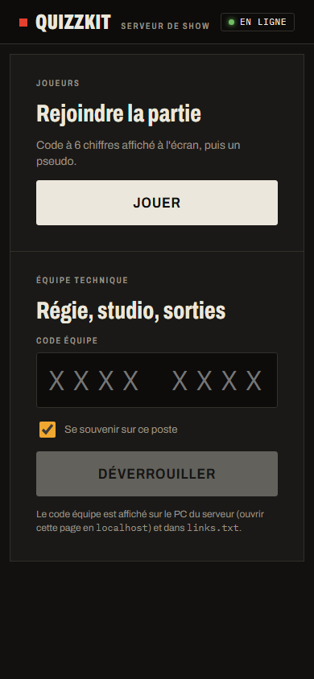</p>

### Studio

Cinq onglets, même logique partout : la liste des parties à gauche, l'édition au centre.

- **Contenu** : la banque de questions. Un bouton par type de question, les bonnes réponses, les indices, les
  catégories, les notes pour l'animateur, un média (image, son, vidéo, avec ses dimensions).
- **Format** : les manches. Le type de manche est un menu visible (Mixte, Buzzer, Paliers, Sondage, Plateau, La
  chaîne…), avec le chrono, le barème (points de base, dégressif selon la rapidité…) et les réglages par
  catégorie de question.
- **Scènes** : ce qui passe à l'antenne. Les calques et leurs zones se placent à la souris sur un canevas
  1920×1080, avec aperçu de chaque état (question ouverte, réponse révélée…) et import d'un PSD du graphiste.
- **Thème** : couleurs générées depuis deux teintes ou le logo (avec contrôle des contrastes), police,
  arrondis, mouvement des animations, pack sonore.
- **Replay** : rejouer une partie jouée, action par action.

« **Envoyer au direct** » applique les modifications à la partie en cours sans la relancer.

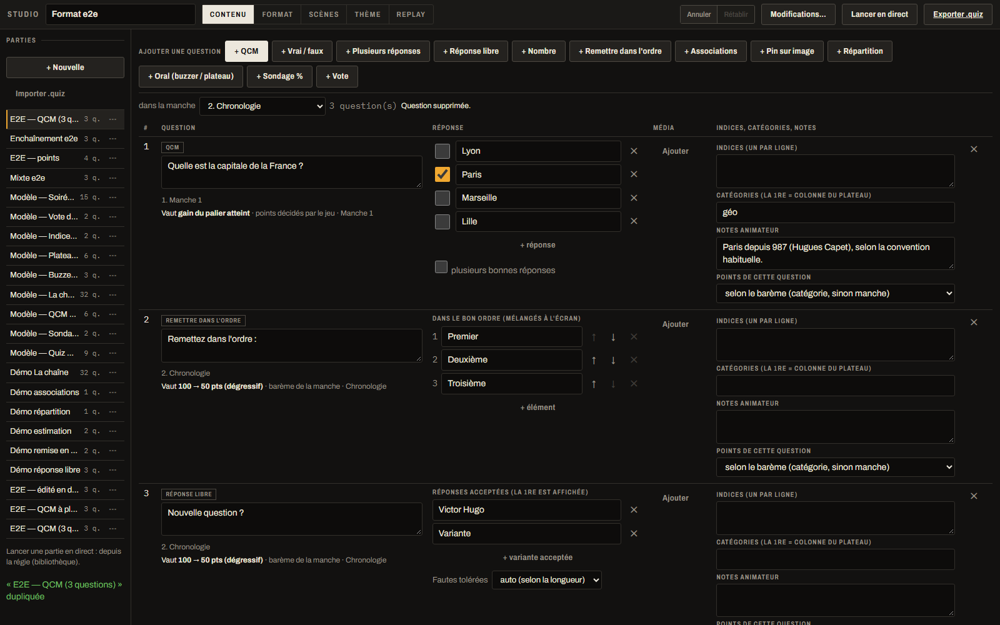
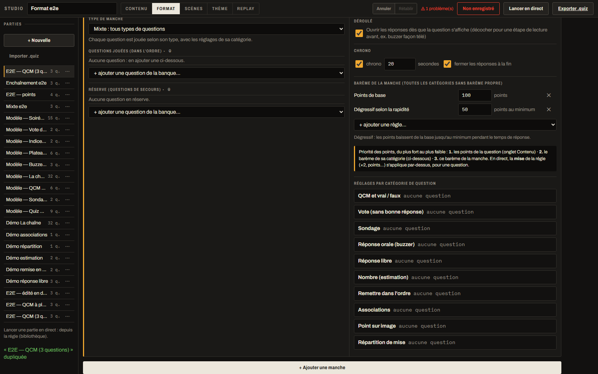
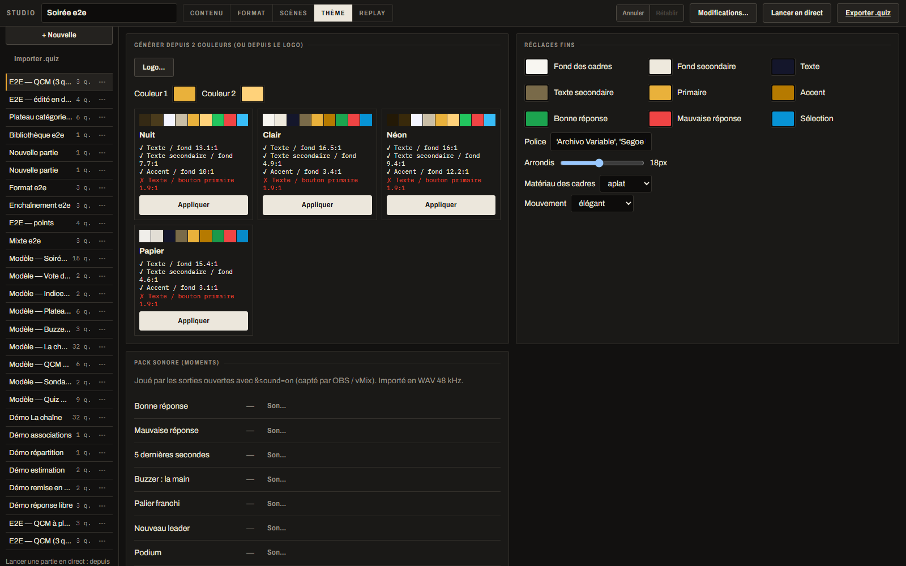

### Régie

L'écran du réalisateur. Une seule touche fait avancer le show : **Espace** = l'étape suivante, écrite en
toutes lettres dans le grand bouton (« Question suivante », « Fermer les réponses », « Révéler »…).

- **Gauche** : le déroulé (manches, questions, saut direct à n'importe quelle question).
- **Centre** : la question à l'antenne, la bonne réponse, les réponses reçues avec les verdicts à corriger
  (✓ / ✗), le chrono (+10 s, stop), la mise (×2, ×3…).
- **Droite** : l'aperçu de la sortie, puis les onglets Parties, Joueurs (points ±, équipes, import Excel),
  Couches (bandeau titre, classement… à faire entrer ou sortir), Outils, Check-list d'avant antenne.
- **Annuler** sur tout ; « Historique des points » pour annuler une ligne précise ; corriger une question
  déjà jouée recalcule les points.

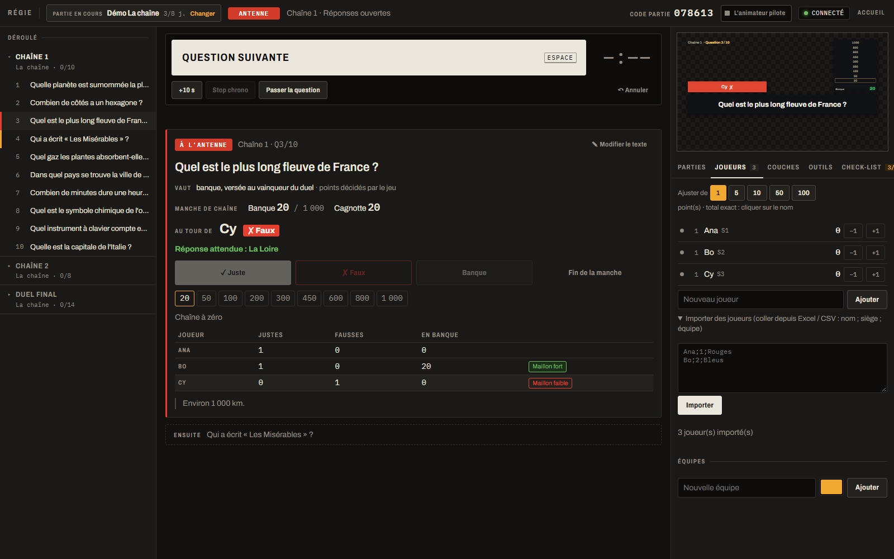

### Animateur

Sur une tablette : la question, **la bonne réponse**, ses notes, la question suivante. Pour les réponses
orales (buzzer, chaîne), il valide d'un geste : **✓ Bonne réponse** / **✗ Faux**. Il peut aussi piloter le
déroulé si la régie le lui confie.

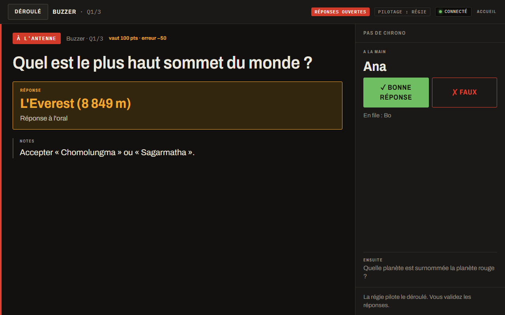

### Tablettes joueurs

N'importe quel appareil (tablette, téléphone, portrait ou paysage). Le joueur rejoint avec le code de la
partie et un pseudo, ou par un siège fixe (QR code collé sur le pupitre). La tablette ne reçoit **jamais** la
bonne réponse avant la révélation.

<p align="center">
  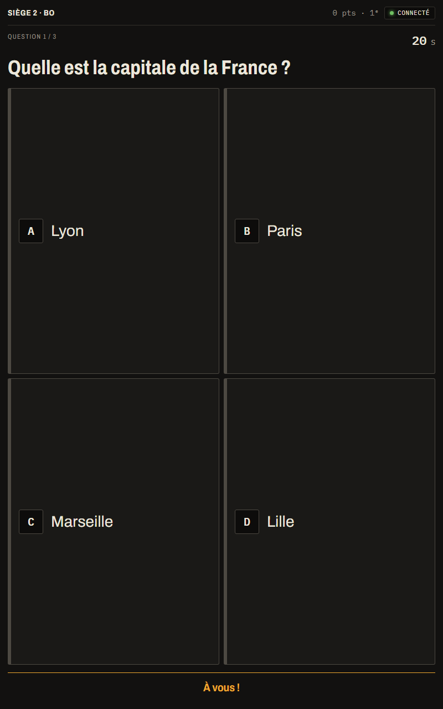
  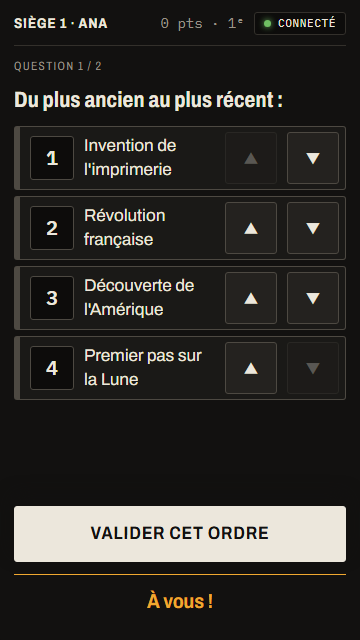
  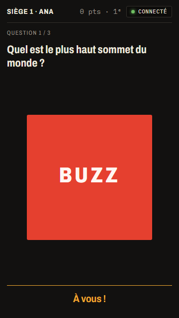
  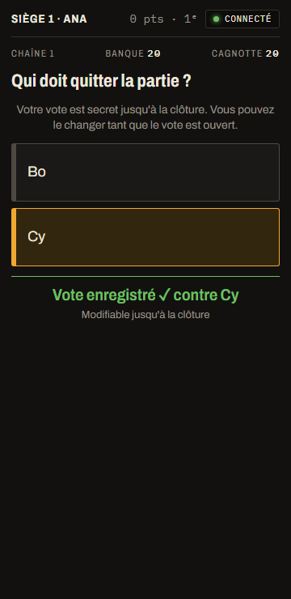
</p>

### Sorties OBS / vMix

Pages 1920×1080 à **fond transparent** (les captures ci-dessous montrent ce fond en blanc), à ajouter comme
« Navigateur » dans OBS ou « Web Browser » dans vMix : programme, mur LED, classement seul. Le son des
moments (bonne réponse, palier, podium…) sort de la page avec `&sound=on`.

| | |
|---|---|
| 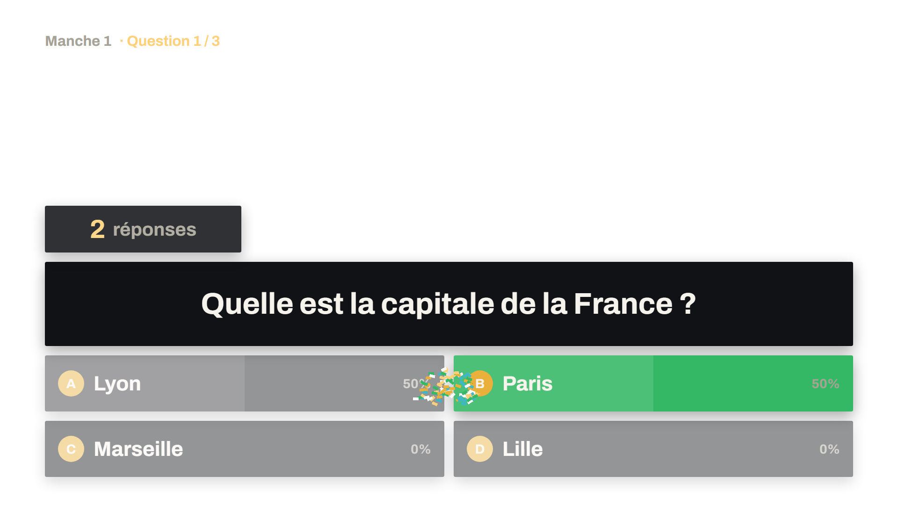 | 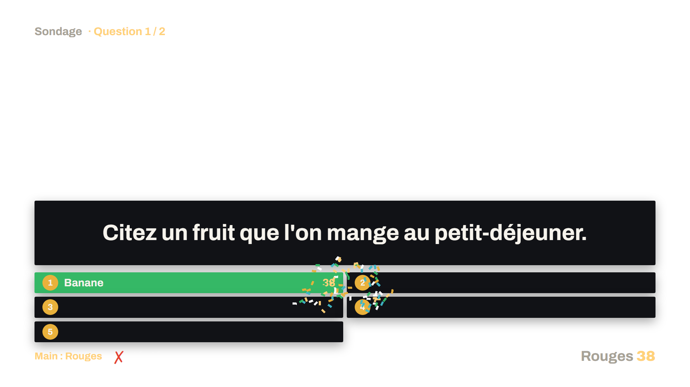 |
| 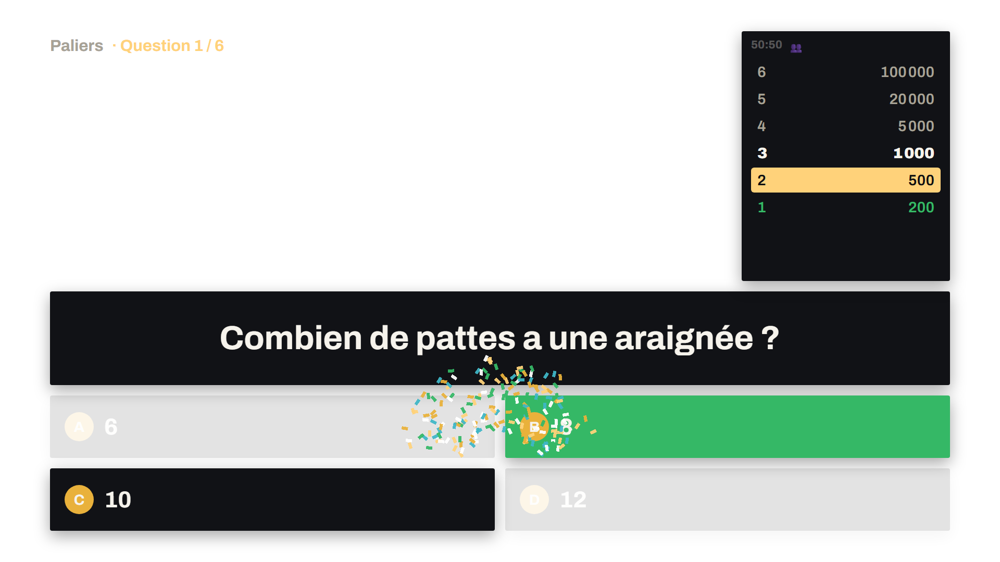 | 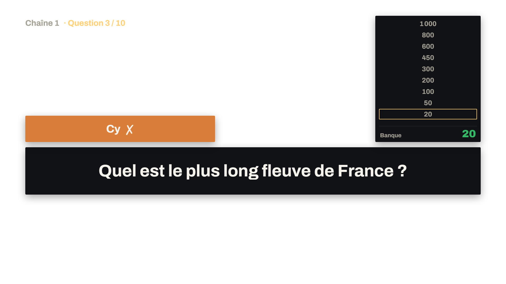 |

---

## Types de questions et de manches

**Questions** : QCM, plusieurs bonnes réponses (comptage choisi en direct par la régie), vrai / faux, vote
(sans bonne réponse), sondage « nous avons demandé à 100 personnes », réponse orale, réponse libre (fautes de
frappe tolérées), nombre (estimation), remettre dans l'ordre, associations, point sur image, répartition de
mise.

**Manches** :

| Type | En bref |
|---|---|
| Mixte | chaque question jouée selon son type |
| Buzzer | le premier qui buzze répond à l'oral, l'animateur valide |
| Paliers | gains croissants, paliers sûrs, jokers (50:50, vote du public) |
| Sondage | trouver les réponses du panel, 3 erreurs par joueur ou équipe, vol |
| Plateau | grille catégories × valeurs, le joueur choisit sa case |
| Indices | les points baissent à chaque indice dévoilé |
| Vote du chat | le chat Twitch / YouTube répond à la majorité pour une équipe |
| Image révélée | l'image se dévoile petit à petit |
| Un seul type | QCM, réponse libre, estimation, remise en ordre, associations, pin sur image ou répartition de mise pour toute la manche |
| La chaîne | chaîne de bonnes réponses, banque, vote d'élimination, duel final |

---

## Démarrer

Prérequis : **Node 26.13** (fixé dans `.node-version`, lu par [fnm](https://github.com/Schniz/fnm)) et
**pnpm 11**.

```sh
pnpm i
pnpm start        # construit les écrans et démarre le serveur de show sous superviseur
```

Puis ouvrir `http://localhost:7300/` sur le PC du serveur. Les adresses réseau, le code équipe et tous les
liens (régie, studio, sorties, sièges) sont aussi écrits dans `apps/server/.data/links.txt`.

Installateur Windows (lanceur qui démarre et relance le serveur) :

```sh
pnpm build && pnpm --filter @quiz/desktop package
```

Variables utiles : `QUIZ_STAFF_CODE` (code équipe fixe), `QUIZ_DATA_DIR` (dossier des données),
`QUIZ_OSC_PORT` + `QUIZ_OSC_ALLOW`, `QUIZ_TWITCH_CLIENT_ID`, `QUIZ_YOUTUBE_API_KEY`, `QUIZ_STANDBY_OF` +
`QUIZ_STANDBY_TOKEN` (serveur de secours).

---

## Un show, pas à pas

1. **Studio** : choisir un modèle de la bibliothèque ou « + Nouvelle », écrire les questions (Contenu),
   composer les manches (Format), habiller (Scènes, Thème).
2. **Régie** → onglet Parties : lancer la partie. Un code de partie à 6 chiffres s'affiche.
3. **OBS / vMix** : ajouter les liens des sorties (copiés depuis l'accueil).
4. **Joueurs** : ils ouvrent l'accueil (QR code) et entrent le code, ou utilisent leur siège fixe. La régie
   crée les équipes et y range les joueurs.
5. **Check-list** (onglet de la régie) : tout est vert ? On passe à l'antenne.
6. **Espace**, **Espace**, **Espace**… la régie suit le grand bouton ; l'animateur valide l'oral.

---

## Fiabilité en direct

- **Le serveur décide de tout** ; les écrans n'envoient que des intentions.
- **Chaque action est écrite sur disque (SQLite) avant d'être diffusée** : un plantage, un redémarrage ou une
  coupure de courant reprend exactement là où on en était (le superviseur relance le serveur tout seul).
- **Reconnexion automatique** des tablettes et des sorties, chronos synchronisés sur l'horloge du serveur.
- **Tout s'annule** et tout se corrige à la main : scores, joueurs, verdicts, texte des questions, chrono.
- **Serveur de secours** : un second PC copie le journal en continu ; bascule manuelle d'un clic
  (voir [docs/05-reliability.md](docs/05-reliability.md)).
- **Zéro internet** pendant le show (sauf chat Twitch / YouTube si utilisé).
- Testé à la charge (`pnpm load`, 500 clients) et à la panne (`pnpm chaos` : arrêt brutal du serveur,
  coupures réseau, rechargements).

---

## Pilotage externe (Stream Deck, OSC, buzzers)

Les mêmes commandes que la régie sont disponibles en HTTP (`/api/v1/<commande>`, état sur `/api/v1/state`)
et en OSC (`/quiz/<commande>`) : Bitfocus Companion, Stream Deck, MIDI, buzzers physiques, scripts.
Mode d'emploi : [docs/api/control.md](docs/api/control.md). Chat Twitch / YouTube : [docs/api/chat.md](docs/api/chat.md).
vMix : [docs/api/vmix.md](docs/api/vmix.md).

---

## Pour les développeurs

Monorepo TypeScript (pnpm + turbo), exécuté directement par Node (sans build pour le code serveur), écrans
en SolidJS.

```
packages/schema     modèles Zod, versions, migrations
packages/engine     règles du jeu : réducteur pur, mécaniques, points, vues par rôle
packages/protocol   messages WebSocket typés, horloge, prochaine étape
packages/renderer   rendu des scènes à l'antenne
packages/ui         composants des écrans internes
apps/server         Fastify + WebSocket + SQLite + médias + API de contrôle
apps/studio         éditeur          apps/control   régie
apps/host           animateur        apps/player    tablettes (PWA)
apps/output         sorties          apps/hub       accueil
apps/desktop        lanceur Windows (Tauri 2)
```

```sh
pnpm dev          # serveur en mode développement
pnpm check        # lint + typecheck + dépendances + tests (à garder au vert)
pnpm test:e2e     # parcours complets dans le navigateur (Playwright) ; captures dans e2e/screenshots/
pnpm load         # charge (k6)
pnpm chaos        # pannes
```

Documentation : [vision](docs/00-vision.md) · [architecture](docs/01-architecture.md) ·
[modèle](docs/02-domain-model.md) · [moteur](docs/03-engine.md) · [temps réel](docs/04-protocol-realtime.md) ·
[fiabilité](docs/05-reliability.md) · [scènes](docs/06-scenes-renderer.md) · [studio](docs/07-studio-editor.md) ·
[régie](docs/08-control-room.md) · [joueurs et points](docs/09-players-scores.md) · [sécurité](docs/10-security.md) ·
[conventions](docs/CONVENTIONS.md) · [feuille de route](docs/ROADMAP.md) · [décisions (ADR)](docs/adr/) ·
[questions ouvertes](docs/OPEN-QUESTIONS.md).

Les captures de ce README viennent des tests de bout en bout (`e2e/screenshots/`).
